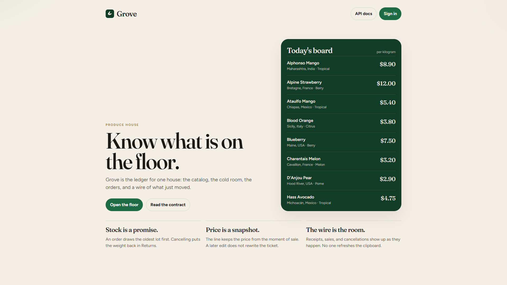
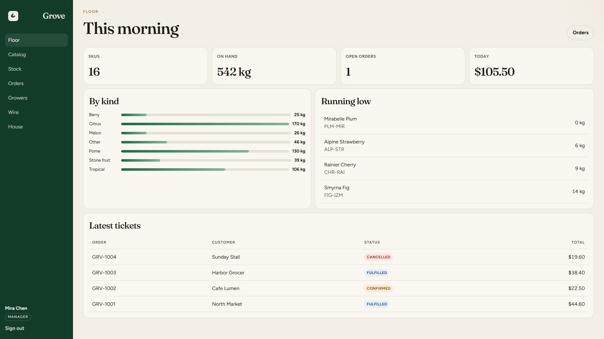
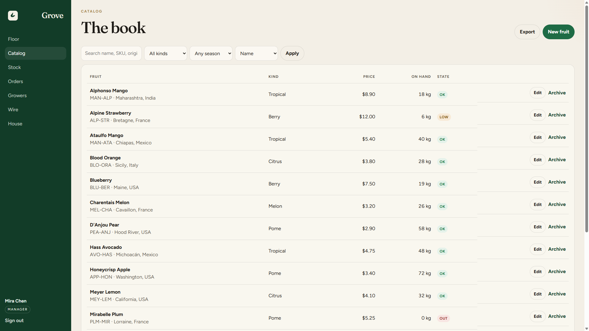
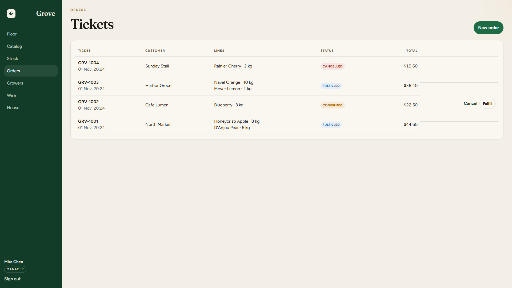
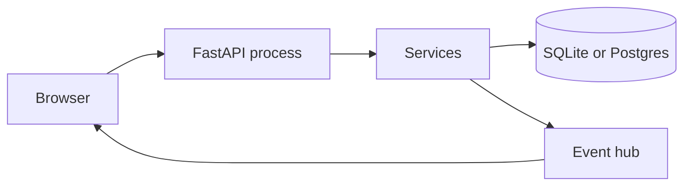

# Grove

Grove is the operations service for a produce house. It keeps the catalog, the cold room, the orders, and a live wire of what just moved.

It began as a small in-memory fruit list. The fruit list is still the heart of it. Everything around that list is what you need once more than one person is allowed to touch the books: accounts, roles, stock that actually moves, and a floor you can stand at.

## Screenshots

The board is public. The floor is what you see after you sign in.

| Public board | Morning floor |
| --- | --- |
|  |  |

| Catalog | Tickets |
| --- | --- |
|  |  |

The pictures are a seeded house after a little use. A fresh database has the same rooms and a clean set of tickets. Numbers move as soon as someone sells.

## Run it

Python 3.11 or newer.

```bash
python -m venv .venv
```

Windows (PowerShell):

```powershell
.\.venv\Scripts\Activate.ps1
pip install -r requirements-dev.txt
uvicorn app.main:app --reload
```

macOS or Linux:

```bash
source .venv/bin/activate
pip install -r requirements-dev.txt
uvicorn app.main:app --reload
```

Open [http://127.0.0.1:8000](http://127.0.0.1:8000).

The first launch creates a SQLite database, builds the tables, and seeds a working house. Copy `.env.example` to `.env` when you want to change any of that.

| | |
| --- | --- |
| Floor | http://127.0.0.1:8000 |
| Swagger | http://127.0.0.1:8000/docs |
| ReDoc | http://127.0.0.1:8000/redoc |
| Health | http://127.0.0.1:8000/health |
| Metrics | http://127.0.0.1:8000/ops/metrics |

## Demo

There is no separate hosted URL. Grove is one process: the floor, the accounts, the stock, and the live wire all live inside it. GitHub Pages only serves files, so it cannot be that process. Start the server above. The seeded house is the demo.

Password for every account: `Harvest2026`

| Email | Role | Can |
| --- | --- | --- |
| admin@grove.example | admin | People, keys, and everything below |
| manager@grove.example | manager | Catalog, stock, growers, fulfill orders |
| clerk@grove.example | clerk | Read the book, sell, cancel an open ticket |

A new registration becomes a clerk. An admin promotes from the house desk.

A short walk:

1. Open the board with no account. The prices are already there.
2. Sign in as Mira. Read the floor, change a price, receive stock, fulfill a ticket.
3. Sign in as Leo. A sale goes through. A price change does not.
4. Open `/docs`, use the password grant, and call the catalog. The username is the email.
5. Leave the wire page open in one window and sell in another. The line shows up as it happens.

These accounts exist only because seeding is on. Set `SEED_ON_STARTUP=false` before any shared deployment. Set a real `SECRET_KEY` before anyone outside your machine can reach the port. The path for that is [docs/deployment.md](docs/deployment.md).

## Architecture

One FastAPI process. The floor is static files on the same origin. Rules sit in services. Routes validate, call a service, and write an audit line. Persistence is SQLAlchemy 2 async: SQLite unless `DATABASE_URL` points at Postgres.



Outermost middleware first: CORS, request id, metrics, rate limit, then gzip. Gzip skips `/api/v1/live` so the stream is not buffered. The database session is a dependency with `yield`: commit on success, rollback on failure, one session for the whole request.

Stock is lots. A sale takes the oldest lot. A cancellation writes the weight back as a lot in Returns. The order line keeps the name, SKU, and unit price from the moment of sale.

The live wire is in-process. One server is the assumption. A second instance would need a shared bus. The hub is the seam.

Local `uvicorn` builds the schema with `create_all` and then seeds an empty database. Compose turns that off and runs `alembic upgrade head`. Do not point both at the same populated database.

The longer map is [docs/architecture.md](docs/architecture.md). The framework surface is [docs/capabilities.md](docs/capabilities.md). Authentication is [docs/authentication.md](docs/authentication.md).

## Why these pieces

Each choice is the smallest thing that still does the job.

- **FastAPI.** HTTP, OpenAPI, dependencies, uploads, websockets, and server-sent events are the product, not a layer in front of it. Custom docs, a mounted `/ops` app, and a static floor sit on the same application.
- **Pydantic v2.** Bodies, the fruit query model, and settings are the same kind of object. A bad request becomes the same problem document as every other error.
- **SQLAlchemy 2, async.** One session style for the SQLite file you get on first launch and for Postgres when you bring Compose or a real host. `aiosqlite` and `asyncpg` are the drivers behind that URL.
- **Alembic.** `create_all` is for an empty local book. A database you mean to keep gets a revision. The two are not mixed on one populated file.
- **PyJWT and bcrypt.** The password grant, the short-lived access token, and rotating refresh tokens stay in this service. An API key is a separate read-only credential. It does not inherit the owner's role.
- **Uvicorn.** It is the ASGI server. Middleware is raw ASGI on purpose: the helper that buffers a response would hold the live stream until it ended.
- **A static floor, no build step.** The UI ships beside the API and talks to the same origin. There is no second package to publish and no token handed to a different host.
- **pytest and httpx.** Tests call the application in process, on a memory database. They never open `grove.db`.

## What the house does

- Public catalog with search, filters, sort, and pages. Writes require scope.
- Stock lots. A sale draws the oldest lot first. A cancellation returns the weight to Returns.
- Orders snapshot the price onto the line, so a later price change does not rewrite the ticket.
- Optimistic updates: `ETag` on a fruit, `If-Match` on the patch.
- `Idempotency-Key` on `POST /orders`, so a retry does not sell the fruit twice.
- OAuth2 password grant, short-lived access tokens, rotating refresh tokens, role scopes.
- Read-only API keys that do not inherit the owner's role.
- Photographs checked by file signature, not by the content-type header.
- CSV export as a stream, a websocket, and a server-sent event stream.
- Floor UI on the same origin: board, book, cold room, tickets, growers, wire, desk.
- Problem documents (`application/problem+json`) for every error, including validation.
- Request ids, rate limits, security headers, and a Prometheus-style `/ops/metrics` scrape.

## How to test

Automated, from the repository root with the dev requirements installed:

```bash
pytest
ruff check app tests
```

The suite uses an in-memory database and does not touch `grove.db`. `APP_ENV=test` skips startup seeding. CI runs the same two commands on Python 3.12.

The tests walk the desk, not the framework in the abstract:

- Health, readiness, and the metrics scrape.
- Register, login, refresh rotation, and the problem document for a bad body.
- Catalog scope, `ETag` / `If-Match`, and archive.
- An order that draws stock once, and a cancel that puts the weight back.
- A read-only API key that cannot write.
- An upload accepted by file signature, and a non-image rejected.
- The morning summary and a stock adjustment.
- The rate-limit window filling up.

Against a server you started yourself:

1. `GET /api/v1/fruits` with no token. The catalog is public.
2. In `/docs`, authorize with the password grant. Username is the email, password is `Harvest2026`.
3. `GET` one fruit, copy the `ETag`, then `PATCH` it with a wrong `If-Match`. Expect 412.
4. `POST /api/v1/orders` twice with the same `Idempotency-Key` and the same body. The second response sets `Idempotent-Replayed: true`. Change the body, keep the key, and expect 409.
5. Sign in as the clerk and try to create a fruit. Expect 403.

## Docker

Quick start above does not need Docker. Compose runs Postgres and applies migrations instead of `create_all`:

```bash
docker compose up --build
```

Set a real `SECRET_KEY` before pointing that stack at anything but your own machine. Production refuses to boot on the development secret.

## Configuration

| Variable | Default | |
| --- | --- | --- |
| `APP_ENV` | `development` | `development`, `test`, or `production` |
| `SECRET_KEY` | development placeholder | Required, and long, when `APP_ENV=production` |
| `DATABASE_URL` | SQLite file `grove.db` | `postgresql+asyncpg://...` in Compose |
| `ACCESS_TOKEN_MINUTES` | `30` | |
| `REFRESH_TOKEN_DAYS` | `14` | |
| `AUTO_CREATE_TABLES` | `true` | Turn off when Alembic owns the schema |
| `SEED_ON_STARTUP` | `true` | Turn off outside a demo |
| `RATE_LIMIT_PER_MINUTE` | `120` | API bucket, per client |
| `AUTH_RATE_LIMIT_PER_MINUTE` | `30` | Login and register bucket |
| `TRUST_PROXY` | `false` | Honor `X-Forwarded-For` only behind a proxy you control |
| `LOW_STOCK_KG` | `15` | Floor warning line |
| `CORS_ORIGINS` | localhost | Comma-separated |
| `MEDIA_DIR` | `media` | Uploads and the receipt log |

## License

MIT. See [LICENSE](LICENSE).
